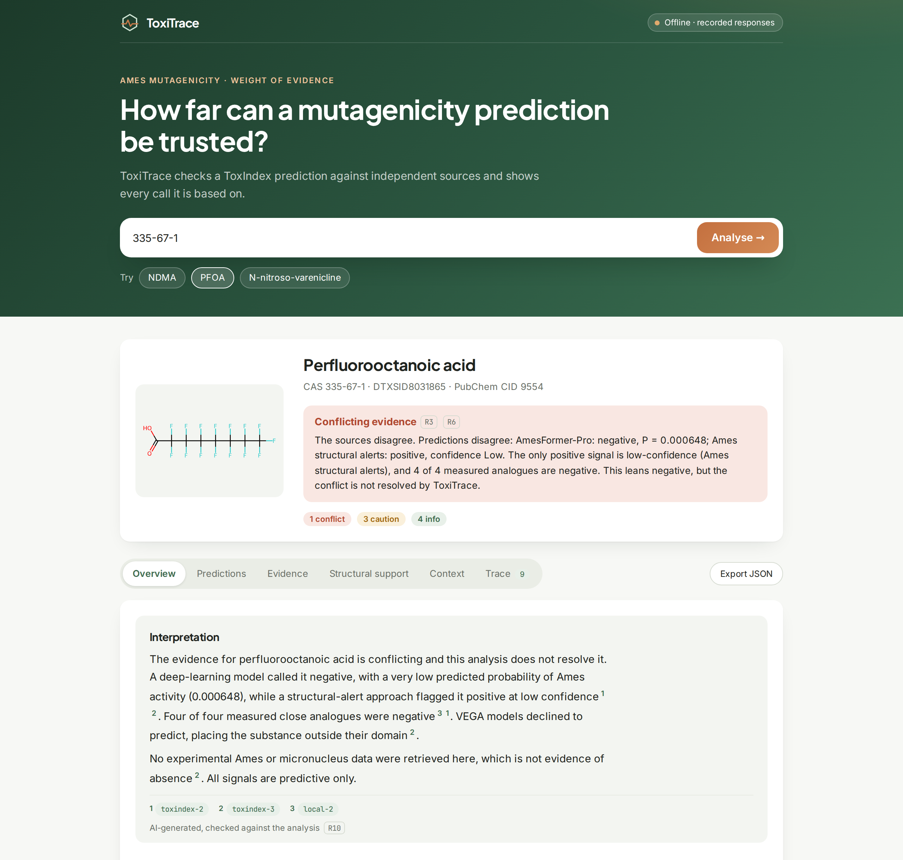
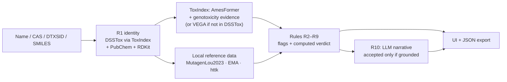

# ToxiTrace

[](https://github.com/mirthhe/toxitrace/actions/workflows/ci.yml)

**How far can an Ames mutagenicity prediction be trusted?** ToxiTrace takes a chemical, retrieves predictions and evidence from [ToxIndex](https://platform.toxindex.com), cross-checks them against independent public sources, and applies deterministic, tested weight-of-evidence rules. Every value it shows can be traced back to the call or file it came from.

ToxiTrace builds on ToxIndex; it does not replace it. ToxIndex's chat agent reasons about evidence well, but in free text. ToxiTrace turns those checks into rules that run every time, produce structured output, and come with unit tests. An LLM explains the computed result, but never decides it.

Built as a time-boxed technical assignment for Insilica. Not production software, and not a regulatory assessment.

**Try it:** **[toxitrace.vercel.app](https://toxitrace.vercel.app)**
- **Public visitors** get the demo mode: the three example chemicals replayed from recorded real API responses, with no API calls.
- **Live mode** (any chemical, live ToxIndex calls and the LLM interpretation) needs an access code, available on request.



## Contents

- [ToxiTrace](#toxitrace)
  - [Contents](#contents)
  - [What it does](#what-it-does)
    - [Three demo cases](#three-demo-cases)
  - [Quick start](#quick-start)
    - [Live mode](#live-mode)
    - [Tests](#tests)
  - [How it works](#how-it-works)
    - [The rules](#the-rules)
    - [Data sources](#data-sources)
  - [Verification](#verification)
    - [Software behaviour](#software-behaviour)
    - [Cross-checks against original sources](#cross-checks-against-original-sources)
    - [Scientific accuracy](#scientific-accuracy)
  - [Limitations](#limitations)
  - [Design decisions](#design-decisions)
  - [What I used, and what I checked myself](#what-i-used-and-what-i-checked-myself)
  - [Repository layout](#repository-layout)
  - [References](#references)

## What it does

**Research question:** for a given chemical, how much should a researcher trust the Ames prediction, and what do independent sources add or contradict?

**Endpoint:** Ames mutagenicity. It is binary, has extensive public experimental data, and is central to regulatory practice (e.g. ICH M7).

**What you get, in one screen:**

- **Identity:** resolved via EPA DSSTox (through ToxIndex) and confirmed independently with PubChem.
- **A computed verdict:** _supported positive/negative_, _conflicting_, _prediction only_ or _insufficient_, with the rules it rests on.
- **Predictions and experimental evidence, kept apart:** model calls and measured results never mix, and sources that returned nothing are listed as _not retrieved_, which is not the same as _negative_.
- **Measured structural analogues:** nearest measured compounds from an independent dataset.
- **Context:** regulatory context for nitrosamines, and toxicokinetic context where data exists.
- **A short plain-language interpretation:** written by an LLM and accepted only if every number and reference in it checks out.
- **The full trace:** every external call and local computation, with request and raw response, plus JSON export.

### Three demo cases

The three chemicals were chosen to cover different evidence situations, not just positives and negatives.

| Chemical                                     | Situation                           | ToxiTrace's verdict                   | Why it is interesting                                                                                                                                                                                                   |
| -------------------------------------------- | ----------------------------------- | ------------------------------------- | ----------------------------------------------------------------------------------------------------------------------------------------------------------------------------------------------------------------------- |
| **NDMA** (CAS 62-75-9)                       | Data-rich nitrosamine               | Supported positive, _not independent_ | The predictions agree with the measured result, but the models were trained on that very result: agreement is expected, not validation.                                                                                 |
| **PFOA** (CAS 335-67-1)                      | No experimental Ames data retrieved | Conflicting, leaning negative         | AmesFormer says negative; a low-confidence structural alert says positive; VEGA declines to predict; measured analogues are negative. ToxIndex's aggregate verdict ("in vitro genotoxicant") rests on predictions only. |
| **N-nitroso-varenicline** (CAS 2755871-02-2) | Not in EPA DSSTox                   | Prediction only                       | A nitrosamine drug impurity (NDSRI). No registry entry, so no curated evidence is retrievable, and the nearest measured analogue has similarity 0.32. EMA lists it at CPCA category 3, 400 ng/day.                      |

The background for these choices is in [docs/science-notes.md](docs/science-notes.md).

## Quick start

**Requirements:**

- Python 3.12+ with [uv](https://docs.astral.sh/uv/);
- Node.js 20+.

**No API keys are needed to try it:** offline mode replays recorded real API responses for the three demo chemicals.

```bash
git clone https://github.com/mirthhe/toxitrace.git
cd toxitrace

# 1. Backend: dependencies and public reference data (downloads ~10 MB, verifies checksums)
cd backend
uv sync
uv run python -m app.reference_data

# 2. Start the backend in offline mode (recorded responses; no ToxIndex or PubChem calls)
TOXITRACE_OFFLINE=true uv run uvicorn app.main:app --port 8000
```

In a second terminal:

```bash
cd toxitrace/frontend
npm install
npm run dev
```

Open <http://localhost:5173> and click one of the three examples.

### Live mode

To analyse other chemicals against the live APIs:

1. Copy [.env.example](.env.example) to `backend/.env` and add a ToxIndex API key. Keys are created at <https://platform.toxindex.com/settings/keys>.
2. Start the backend without `TOXITRACE_OFFLINE`.

Each analysis then makes at most 3 ToxIndex calls and 1–2 PubChem calls.

**The interpretation text:** if `LLM_API_KEY` is set in `backend/.env`, each analysis makes one Claude API call to write it. That applies in offline mode too. Without the key, a deterministic template is used.

### Tests

Run these from `backend/`:

```bash
uv run pytest                   # 106 unit and API tests on recorded responses; offline, no keys
uv run ruff check app tests     # lint
uv run pytest -m live           # opt-in contract tests against the live APIs (3 ToxIndex calls)
```

Run them from `frontend/`:

```bash
npm run lint && npm run build
```

[CI](.github/workflows/ci.yml) runs the unit tests (Python 3.12 and 3.14), lint and the frontend build on every push. It never runs live tests.

## How it works



**Every step leaves a trace entry:** source, request, sanitised response, status, duration and timestamp. The UI links each flag and each citation to its entry.

### The rules

Each rule is a small pure function with unit tests built from real responses. Details and rationale: [docs/plan.md](docs/plan.md).

| Rule                          | Checks                                                                                           | Example                                                      |
| ----------------------------- | ------------------------------------------------------------------------------------------------ | ------------------------------------------------------------ |
| **R1** Identity               | Do DSSTox and PubChem agree (by InChIKey)? Ambiguous input stops the analysis.                   | N-nitroso-varenicline: not in DSSTox, confirmed by PubChem   |
| **R2** Predicted ≠ observed   | Findings are sorted by their upstream `method` label, not by which tool returned them.           | PFOA: ToxIndex's verdict rests on predictions only           |
| **R3** Disagreement           | Conflicting predictions, or predictions contradicted by measurements, are shown, never averaged. | PFOA: AmesFormer negative vs alert positive                  |
| **R4** Applicability domain   | A model that declines to predict is a signal.                                                    | PFOA: no VEGA model reliable                                 |
| **R5** Independence           | Agreement with data the model was trained on is not validation.                                  | NDMA: in the training split                                  |
| **R6** Structural support     | Nearest measured analogues (Morgan r2, Tanimoto, threshold 0.4); identity always by InChIKey.    | N-nitroso-varenicline: best similarity 0.32                  |
| **R7** Not retrieved ≠ absent | Sources that returned nothing are listed, never read as negative.                                | PFOA: 4 sources not retrieved                                |
| **R8** Nitrosamine context    | ICH M7 cohort of concern; EMA CPCA category and acceptable intake.                               | NDMA 96 ng/day; N-nitroso-varenicline category 3, 400 ng/day |
| **R9** Toxicokinetics         | httk context where it exists; says so plainly where it does not.                                 | PFOA half-life: 2.8 h (female rat) to 2.6 years (male human) |
| **R10** Grounded narrative    | Every cited reference must exist in the trace; every number must come from the analysis.         | Otherwise the template is shown, with the reason             |

**The verdict is computed from the flags and is never generated.** Where a conflict leans one way, for example when the only positive signal is a low-confidence alert, the explanatory text says so, but the label stays _conflicting_: weighing the evidence is left to the researcher.

### Data sources

| Source                                                                                                                                              | Access              | Used for                                             | Licence          |
| --------------------------------------------------------------------------------------------------------------------------------------------------- | ------------------- | ---------------------------------------------------- | ---------------- |
| ToxIndex: `tox_chemical_identity`, `toxjobs_predict` (AmesFormer, VEGA), `tox_genotoxicity`                                                         | API                 | Identity, predictions, curated evidence              | —                |
| PubChem PUG REST                                                                                                                                    | API                 | Independent identity check                           | Public domain    |
| [MutagenLou2023](https://huggingface.co/datasets/maomlab/MutagenLou2023) (pinned commit)                                                            | Downloaded at setup | Measured analogues; training-data proxy              | CC BY 4.0        |
| [httk 2.7.4](https://cran.r-project.org/package=httk) data tables                                                                                   | Downloaded at setup | Toxicokinetic context                                | GPL-3            |
| [EMA nitrosamine acceptable intakes](https://www.ema.europa.eu/en/documents/other/appendix-1-acceptable-intakes-established-n-nitrosamines_en.xlsx) | Downloaded at setup | CPCA category, acceptable intake (revision recorded) | EMA legal notice |
| Claude API (`claude-opus-5`)                                                                                                                        | API, optional       | Interpretation text only                             | —                |

**Reference data:**

- It is downloaded rather than committed, because licences vary.
- `data/manifest.json` records each file's source, SHA-256 and retrieval time.
- Pinned files are refused if their checksum changes.
- Datasets without a licence grant (Hansen, ISSSTY) are never stored in this repository.

## Verification

### Software behaviour

| Scenario (SPEC §7)               | Expected                          | Result                                                                                                                              |
| -------------------------------- | --------------------------------- | ----------------------------------------------------------------------------------------------------------------------------------- |
| Valid chemical                   | Real model data rendered          | ✅ All three demo chemicals, end to end through the API, on recorded real responses (`tests/test_pipeline.py`, `tests/test_api.py`) |
| Empty input                      | Validation error                  | ✅ 422 from the API; message in the UI                                                                                              |
| Invalid identifier               | Error, no fabricated result       | ✅ Wrong CAS check digit → 400 before any lookup; an unknown name → "not found", no structure invented                              |
| API timeout or 429               | Clear failure state               | ✅ Tested with mocked responses: the failed call is traced and listed as not retrieved; the analysis continues where it can         |
| Grounding check                  | UI values match raw API responses | ✅ Values are parsed from recorded responses and asserted in the tests; the LLM narrative is checked against the trace (R10)        |
| Failure of an independent source | Degrades, not breaks              | ✅ PubChem outage → caution flag; missing reference data → reported as not installed                                                |
| Live API contract                | Fields still match the recordings | ✅ 2026-10-22: `pytest -m live` passed (3/3); all three demo chemicals run end to end against the live APIs. Every ToxIndex response (9 calls) was identical to its recording, so offline mode reproduces the live results exactly; all three LLM interpretations passed the grounding check |
| Fresh setup                      | Commands work as written          | ✅ 2026-10-22: cloned from GitHub into an empty folder and followed the Quick start literally (no `.env`, no data). Reference data downloaded and verified in 22 s; all three examples render with the correct verdict, every tab populated, no console errors; 97 tests, lint and frontend build pass. CI is green |

### Cross-checks against original sources

During discovery, ToxIndex outputs were compared with data obtained directly from the original publishers. Details and dates are in [docs/discovery-notes.md](docs/discovery-notes.md).

| What                                                        | Result                                                                                                                            |
| ----------------------------------------------------------- | --------------------------------------------------------------------------------------------------------------------------------- |
| MutagenLou2023 (ToxIndex kiln copy vs HuggingFace original) | Agrees (10,045 rows)                                                                                                              |
| N-nitroso-varenicline structure                             | PubChem, EMA and our constructed SMILES agree                                                                                     |
| PFOA read-across by the ToxIndex chat agent                 | Confirmed on the original dataset: nearest measured analogues are Ames-negative                                                   |
| httk coverage                                               | The ToxIndex httk tool reports ~553 chemicals and found neither NDMA nor PFOA; httk 2.7.4 on CRAN contains 18,476, including both |
| PFOA IARC classification                                    | The ToxIndex chat agent cited Group 2B; IARC Monographs Vol. 135 (2023) classifies PFOA as Group 1                                |

### Scientific accuracy

**A small independent benchmark of AmesFormer-Pro** ([method and caveats](docs/benchmark.md), [results](benchmark/results.md)).

**Setup:**
- 40 compounds (20 positive, 20 negative) from the MutagenLou2023 external validation split.
- Any compound whose skeleton also occurs in AmesFormer's stated training sources (Hansen, ISSSTY) was excluded.
- Both classes were restricted to single small organic molecules (MW ≤ 500), so molecular size cannot separate them.

**Results:**

| Method | Sensitivity | Specificity | Balanced accuracy |
|---|---|---|---|
| AmesFormer-Pro (P ≥ 0.5) | 0.95 (95% CI 0.76–0.99) | 0.90 (0.70–0.97) | 0.93 |
| Nearest-neighbour read-across (local baseline) | 0.70 (0.48–0.85) | 0.90 (0.70–0.97) | 0.80 |

**What this shows:**
- On this sample, AmesFormer-Pro performs well on compounds outside its stated training sources, and beats naive read-across, mainly on sensitivity.
- **The sample is small, and the intervals overlap.**
- The positives are *strong* Ames positives, so real-world sensitivity is likely lower.
- Overlap with AmesFormer's third training source (EURL) could not be checked.
- The independent pool contains almost no nitrosamines, **so the benchmark says nothing about that class.** That is why ToxiTrace shows per-query structural support (R6) rather than relying on a global accuracy figure.

VEGA was not benchmarked.

## Limitations

- **Scope:** Ames only (gene mutations). A negative result does not exclude clastogenic or aneugenic effects, or non-genotoxic carcinogenicity.
- **Experimental detail:** results are shown as overall calls. Strain-level and S9 (metabolic activation) detail, which matters for interpretation (e.g. NDMA is positive only with S9), is not displayed.
- **No applicability domain for AmesFormer-Pro:** its probability is a model score, not a reliability measure.
- **Training-data proxy:** "in the training data" is approximated by the MutagenLou2023 train/test splits, which come from Hansen and ISSSTY. AmesFormer's third stated source, EURL, is not covered.
- **Similarity:** Morgan fingerprints (radius 2) cannot distinguish some homologues; PFOA and its C10 homologue score 1.0. Identity is therefore always checked by InChIKey. The 0.4 threshold is a heuristic, and the raw similarity is always shown.
- **No literature search:** experimental data that exists only in the literature is reported as _not retrieved_. For N-nitroso-varenicline, an enhanced Ames test was reported positive by FDA researchers; ToxiTrace correctly does not claim absence, but it does not find that data either.
- **Interpretation text:** written by an LLM. It is checked for grounded numbers and references, but not for every nuance of wording.
- **Not a regulatory assessment.**

What would come next, and how this could grow into a product: [docs/roadmap.md](docs/roadmap.md).

## Design decisions

| Decision                                                            | Rationale                                                                                                                                                                                                          |
| ------------------------------------------------------------------- | ------------------------------------------------------------------------------------------------------------------------------------------------------------------------------------------------------------------ |
| A deterministic pipeline plus one LLM step, not an autonomous agent | Reproducible and testable; the LLM explains but does not decide.                                                                                                                                                   |
| Build on ToxIndex instead of replicating it                         | ToxIndex's chat agent already reasons well in prose; the gap is reproducible, structured, tested checks.                                                                                                           |
| Cross-check against original sources                                | Discrepancies only become visible when you look; two were found during discovery.                                                                                                                                  |
| Classify findings by upstream `method`, not by tool                 | ToxIndex's evidence tool also returns predictions.                                                                                                                                                                 |
| At most 3 ToxIndex calls per analysis                               | ToxIndex is a shared service; the evidence tool is only called for substances in DSSTox, and VEGA is called directly otherwise.                                                                                    |
| Unit tests on recorded responses; live tests opt-in                 | Deterministic tests that can simulate failures, without load on shared services. See [AGENTS.md](AGENTS.md).                                                                                                       |
| Offline replay mode                                                 | Reviewers can run the app without keys; development causes no API traffic.                                                                                                                                         |
| `claude-opus-5` for the narrative                                   | `claude-opus-5-5`'s safety classifiers consistently declined this toxicology content in testing (the server-side fallback then answered with Opus 5), so Opus 5 is requested directly. The fallback stays enabled. |
| BioBricks via kiln / the original instead of a separate client      | The relevant datasets were reachable without a second integration; see [discovery notes](docs/discovery-notes.md#biobricks-decision).                                                                              |

## What I used, and what I checked myself

**What I used:** [Claude Code](https://claude.com/claude-code), with Claude Opus 5.5, as a coding agent throughout. It explored the ToxIndex API and wrote code, tests and documentation.

**What I did myself:**

- **Direction and scope:** chose the research question and the three demo chemicals, steering away from textbook examples towards cases that test the limits of a prediction.
- **Design decisions:** made each one, after weighing the agent's options. Among them:
  - building a trust layer on ToxIndex rather than a second ToxIndex;
  - the similarity threshold;
  - keeping a conflicting verdict as _conflicting_, with an explanatory note;
  - the narrative model;
  - which optional features to build;
  - the interface design.
- **API usage:** approved every live ToxIndex call before it was made, and set the policy that development and tests run on recorded responses ([AGENTS.md](AGENTS.md)).

**What I checked myself:**

- **Against ToxIndex's own chat agent:** asked it the same Ames question for all three demo chemicals, and compared its answers with ToxiTrace's output. This changed the positioning: for data-rich chemicals the chat agent is often more thorough, so ToxiTrace focuses on reproducible checks, structured output, independent cross-checks, and the edge cases. It also led to a correction in [docs/science-notes.md](docs/science-notes.md) and to closing a gap: calling VEGA directly for substances outside DSSTox.
- **Against independent sources:** asked for cross-checks against the original publishers rather than relying on one platform. That is where the httk and IARC discrepancies above came from.
- **The results in the running app:** reviewed them for all three chemicals. This caught an interpretation text that was rejected for the wrong reason (a bug in the grounding check), and a model choice that turned out to be declined consistently.
- **The documentation:** reviewed it for accuracy and for this audience. Scientific claims that I have not verified against a primary source are labelled as such in [docs/science-notes.md](docs/science-notes.md).

**What the tests check, and what they don't:**

- **They check:** that the code does what the rules describe, on real recorded responses.
- **They don't check:** whether the predictions themselves are right. See [Scientific accuracy](#scientific-accuracy).

## Repository layout

| Path                   | Contents                                                                                                                           |
| ---------------------- | ---------------------------------------------------------------------------------------------------------------------------------- |
| `backend/app/`         | FastAPI app: adapters (ToxIndex, PubChem), identity (R1), findings, rules (R2–R9), narrative (R10), reference data, offline replay |
| `backend/recordings/`  | Recorded real API responses (used by the tests and offline mode)                                                                   |
| `backend/tests/`       | Unit, pipeline and API tests; `live/` holds opt-in contract tests                                                                  |
| `benchmark/`           | Cached AmesFormer predictions and the generated benchmark report (`uv run python -m app.benchmark`)                               |
| `frontend/src/`        | React + TypeScript UI                                                                                                              |
| `docs/`                | [Design plan](docs/plan.md), [API discovery notes](docs/discovery-notes.md), [scientific rationale](docs/science-notes.md), [benchmark](docs/benchmark.md), [roadmap](docs/roadmap.md) |
| [SPEC.md](SPEC.md)     | The original specification for this assignment                                                                                     |
| [AGENTS.md](AGENTS.md) | Working agreements: API usage policy, data and licensing rules                                                                     |

## References

- [ToxIndex API](https://platform.toxindex.com/v1/openapi.json)
- [PubChem PUG REST](https://pubchem.ncbi.nlm.nih.gov/docs/pug-rest)
- [MutagenLou2023](https://huggingface.co/datasets/maomlab/MutagenLou2023)
- [httk (Pearce et al. 2017, _J. Stat. Softw._ 79(4))](https://cran.r-project.org/package=httk)
- [EMA, acceptable intakes for N-nitrosamines](https://www.ema.europa.eu/en/documents/other/appendix-1-acceptable-intakes-established-n-nitrosamines_en.xlsx)
- [IARC Monographs Vol. 135 (PFOA, PFOS)](https://publications.iarc.who.int/Book-And-Report-Series/Iarc-Monographs-On-The-Identification-Of-Carcinogenic-Hazards-To-Humans/Perfluorooctanoic-Acid-PFOA-And-Perfluorooctanesulfonic-Acid-PFOS--2025)
- ICH M7(R2), assessment and control of DNA-reactive (mutagenic) impurities
